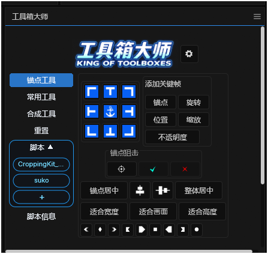

# 工具箱大师 · EffectCraft 移植版

EffectCraft 版「工具箱大师」面板：原版 AE ScriptUI 脚本 + 兼容层 + 布局适配，界面与原版保持一致。

## 下载与安装

- 最新版本：[GitHub Releases](https://github.com/KOGGUA-EDIT/gongjuxiangdashi/releases/latest)
- 下载 `工具箱大师-EC移植.jsx`，复制到 `%APPDATA%\EffectCraft\Scripts\ScriptUI Panels\`
- 打开 EffectCraft → 菜单「窗口」→「工具箱大师」（面板需关掉重开才会加载新版本）

源码、构建说明与更新记录见 [ec-port 分支](https://github.com/KOGGUA-EDIT/gongjuxiangdashi/tree/ec-port)。

## 特性

- 保留原版界面与按钮图，5 个常用页：锚点工具 / 常用工具 / 合成工具 / 重置 / 脚本信息
- 左侧「脚本」展开栏：常用 .jsx 一键添加、命名、悬浮窗运行
- 中英双语界面，设置里可切换
- 针对 EffectCraft 的兼容层（完整已知限制见分支 README）